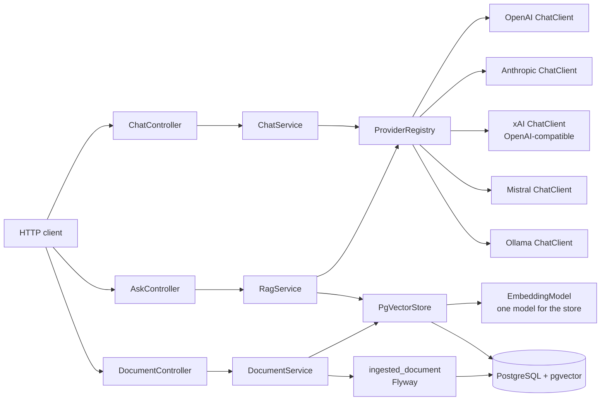
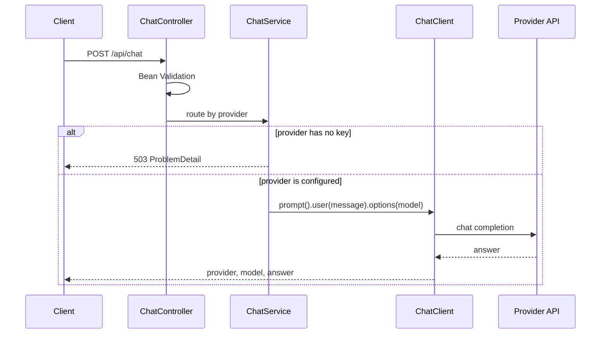
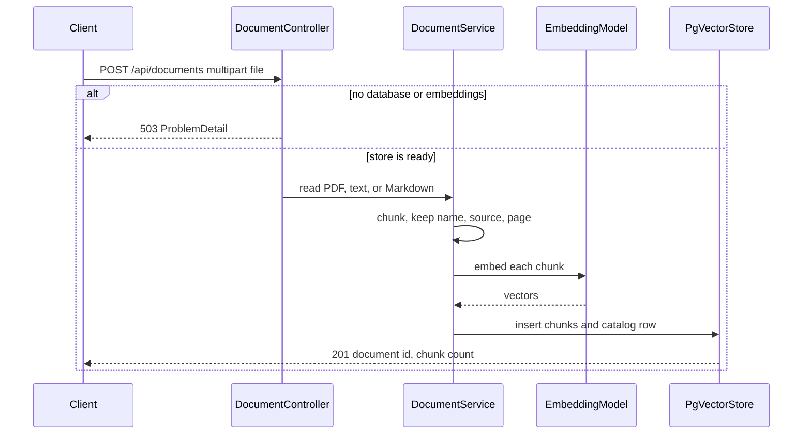
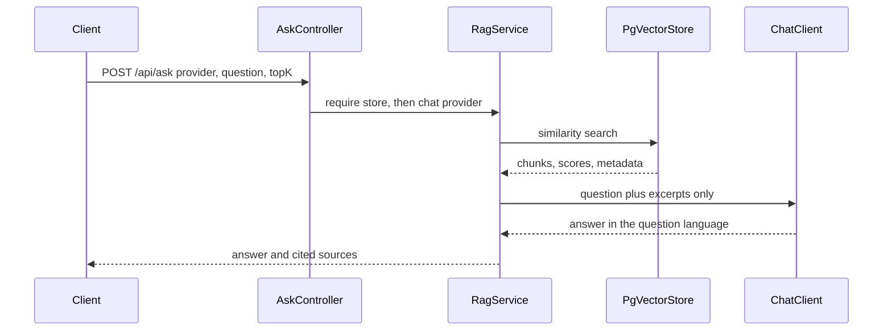

# LLM Gateway

A small Spring Boot service that sends one chat message to **OpenAI**, **Anthropic**, **xAI Grok**, **Mistral**, or a local **Ollama** server, and answers questions from documents you upload. The caller picks the chat provider on each request. Retrieval uses one embedding model for the whole store, then PostgreSQL with [pgvector](https://github.com/pgvector/pgvector).

Retrieval-augmented generation (RAG) means the service does not ask the model to answer from memory. It first searches the uploaded documents for the passages that look closest to the question, then asks the model to answer using only those passages and to say so when they do not contain the answer.

It is meant as a portfolio slice: one clear HTTP contract, keys only in the environment, a consistent error shape, OpenAPI, and tests that never touch a live model.

```bash
curl -s http://localhost:8080/api/chat \
  -H 'Content-Type: application/json' \
  -d '{"provider":"grok","message":"Explain virtual threads"}'
```

```json
{"provider":"grok","model":"grok-4.7","answer":"..."}
```

There is no authentication. Do not put this on a public network with live API keys.

## Features

- `POST /api/chat` selects the provider per request, with an optional model override.
- `GET /api/providers` shows which providers are configured. API keys are never returned.
- `POST /api/documents` ingests a PDF, UTF-8 text, or UTF-8 Markdown file: read, chunk, embed, store.
- `GET /api/documents` and `DELETE /api/documents/{id}` list and remove ingested documents. Chunks keep the file name, source, and PDF page.
- `POST /api/ask` retrieves the nearest chunks and asks the selected chat provider to answer only from them, in the language of the question (French, Dutch, or English). The response includes the cited chunks and their similarity scores.
- `GET /api/rag` reports whether retrieval is configured. A missing database or embedding key does not stop startup. Those routes answer `503`, the same way an unconfigured chat provider does.
- A missing chat key does not stop startup. That provider answers `503` with the environment variable to set.
- Bean Validation on the body, and RFC 9457 `ProblemDetail` errors from one handler.
- Swagger UI at [/swagger-ui.html](http://localhost:8080/swagger-ui.html).
- Java 21 virtual threads for the blocking HTTP calls out to providers.

## Architecture

Each chat provider is a `ChatProvider` built at startup from the official Spring AI 1.1 starter classes (`OpenAiChatModel`, `AnthropicChatModel`, `MistralAiChatModel`, `OllamaChatModel`) and wrapped in a `ChatClient`. xAI Grok reuses the OpenAI client with base URL `https://api.x.ai`. The OpenAI client appends `/v1/chat/completions`, which is xAI's legacy chat-completions endpoint. xAI does not provide embeddings, and this service does not pretend that it does.

Spring AI's starters auto-configure a single chat model, and in 1.1 that auto-configuration turns on when `spring.ai.model.chat` is unset. With four starters on the classpath, leaving it unset would try to build every provider, and a missing key would fail startup. `application.yml` sets those model properties to `none` and builds a `ChatClient` only when the matching key is present (Ollama when it is enabled). The starter artifacts stay on the classpath so the gateway uses the supported client API rather than a hand-rolled HTTP client.

Embeddings are separate from that choice. Every chunk and every question is embedded with the same model, so vectors in `vector_store` stay comparable. The chat provider is still chosen per `/api/ask` call and only writes the answer.

PostgreSQL is optional at startup. JDBC and Flyway auto-configuration are turned off. `RagDataSourceConfiguration` opens a pool only when `SPRING_DATASOURCE_URL` is set. Flyway then creates the `ingested_document` catalog. Spring AI's `PgVectorStore` creates the `vector_store` table (extension `vector`, HNSW index, cosine distance) because `initializeSchema` is set on that bean. Flyway does not create `vector_store`. The two schemas are split so the catalog stays an explicit migration and the vector table stays the one Spring AI knows how to query.









## Endpoint contract

### `POST /api/chat`

| Field | Required | Notes |
| --- | --- | --- |
| `provider` | yes | `openai`, `anthropic`, `grok`, `mistral`, or `ollama` |
| `message` | yes | Trimmed, 1–32000 characters |
| `model` | no | Overrides the provider default. At most 128 characters |

`200` body:

| Field | Notes |
| --- | --- |
| `provider` | The provider that answered |
| `model` | Model id from the provider metadata, or the model that was requested |
| `answer` | Assistant text |

Errors are `application/problem+json`:

| Status | When |
| --- | --- |
| `400` | Malformed JSON, unknown provider, or validation failure (`errors` lists fields) |
| `502` | The provider was called and failed, was unreachable, or returned an empty answer |
| `503` | The provider is known but not configured |

`503` example:

```json
{
  "title": "Provider not available",
  "status": 503,
  "detail": "Provider 'openai' is not available. Set the OPENAI_API_KEY environment variable.",
  "instance": "/api/chat",
  "provider": "openai"
}
```

### `GET /api/providers`

Returns every supported provider, in a stable order. `available` means the process can try a call. For Ollama that means the provider is enabled, not that the daemon is up. `reason` is omitted when the provider is available.

### `POST /api/documents`

Multipart form. Part `file` is required (PDF, `.txt`, `.md`, or `.markdown`, at most 10 MB). Part `source` is optional and defaults to `upload`. Letters, digits, and `.` `_` `:` `-`, at most 64 characters. Sample files use `sample`.

PDF pages are read with Spring AI's `PagePdfDocumentReader`. Text and Markdown are decoded as UTF-8. Markdown is split on headings first, then every piece is split with `TokenTextSplitter`. Each chunk stores `documentId`, `documentName`, `source`, `chunk` (zero-based), `mediaType`, and `page` when the source is a PDF.

`201` means the bytes were new. `200` means the same SHA-256 was already stored: the existing catalog row is returned and nothing is embedded again. The body is the same either way.

| Field | Notes |
| --- | --- |
| `id` | UUID |
| `name` | File name, path stripped |
| `mediaType` | `application/pdf`, `text/plain`, or `text/markdown` |
| `source` | The label you sent, or `upload` |
| `byteSize` | Size of the uploaded bytes |
| `chunkCount` | Chunks written to `vector_store` |
| `ingestedAt` | UTC timestamp |

| Status | When |
| --- | --- |
| `400` | Empty file, bad file name, text that is not UTF-8, or a PDF with no extractable text |
| `413` | Larger than 10 MB |
| `415` | Not a PDF, text, or Markdown file |
| `502` | The embedding provider was called and failed |
| `503` | No database, or the embedding provider is not configured |

### `GET /api/documents`

Catalog, newest first. Chunk text is not included.

### `GET /api/documents/{id}`

One catalog row. `404` with `documentId` when the id is unknown. A path that is not a UUID is `400`.

### `DELETE /api/documents/{id}`

`204` after the catalog row and every chunk with that `documentId` are removed.

### `POST /api/ask`

| Field | Required | Notes |
| --- | --- | --- |
| `provider` | yes | Chat provider that writes the answer. Same values as `/api/chat` |
| `question` | yes | Trimmed, 1–32000 characters. French, Dutch, and English |
| `model` | no | Overrides that provider's chat model |
| `topK` | no | How many chunks to retrieve. Default `RAG_TOP_K` (4). Range 1–10 |

The question is embedded with the configured embedding model, not with the chat provider. The nearest chunks above `RAG_SIMILARITY_THRESHOLD` are placed in the prompt as untrusted excerpts. The instruction tells the model to use only those excerpts, to say when the answer is not in the documents, and to reply in the language of the question. If nothing is retrieved, the model still gets that instruction and an explicit empty context.

`200` body:

| Field | Notes |
| --- | --- |
| `provider`, `model`, `answer` | Same meaning as `/api/chat` |
| `sources` | Retrieved chunks, best first. Empty when nothing passed the threshold |

Each source:

| Field | Notes |
| --- | --- |
| `documentId`, `documentName` | Catalog identity |
| `page` | 1-based PDF page. Omitted for text and Markdown |
| `chunk` | Zero-based index inside the document |
| `snippet` | Whitespace-collapsed extract, at most 400 characters |
| `score` | Cosine similarity, `1 - cosine distance`. Higher is closer. About 0.3 is a weak match for the default local model; a close paraphrase is often near 0.6 |

| Status | When |
| --- | --- |
| `400` | Malformed JSON, unknown provider, or validation failure |
| `502` | The embedding call or the chat call failed, or the chat model returned an empty answer |
| `503` | Retrieval is not configured, or the selected chat provider is not configured |

Retrieval is checked first. A missing database is `503` even when the chat key is also missing.

### `GET /api/rag`

| Field | Notes |
| --- | --- |
| `available` | True when a database is connected, the embedding model can be built, and the `vector_store` column width matches that model |
| `embeddingProvider` | `transformers`, `openai`, or `ollama` |
| `embeddingModel` | Model id |
| `dimensions` | Width written into `vector(n)` |
| `vectorStore` | `pgvector` |
| `reason` | Omitted when `available` is true |

## Embeddings

The chat provider changes per request. The embedding model must not, or old vectors and new queries land in different spaces. This service therefore has a single `EMBEDDING_PROVIDER`.

**Default: `transformers`.** A local ONNX export of [`sentence-transformers/paraphrase-multilingual-MiniLM-L12-v2`](https://huggingface.co/sentence-transformers/paraphrase-multilingual-MiniLM-L12-v2) (384 dimensions, max 128 tokens, Apache-2.0). The files actually loaded are the int8 ONNX and `tokenizer.json` from [`Xenova/paraphrase-multilingual-MiniLM-L12-v2`](https://huggingface.co/Xenova/paraphrase-multilingual-MiniLM-L12-v2), which is that same model converted to ONNX. Spring AI's `TransformersEmbeddingModel` runs it with ONNX Runtime and mean-pools `last_hidden_state`. No API key. The first ingest or question downloads about 130 MB of model files into `TRANSFORMERS_CACHE_DIR`, plus DJL's small PyTorch CPU libraries into the user home. After that, embedding stays on the machine.

That model is the default because the sample corpus and the questions are French, Dutch, and English, and a Belgian mutuality assistant that only embeds English would miss the documents it is supposed to cite. It is also the choice that lets `docker compose up` demonstrate `/api/ask` without a paid key. It is not the highest-quality embedder: the window is 128 tokens, so the default chunk size is 120, and a large corpus would want a stronger model.

**`openai`:** `text-embedding-3-small` (1536 dimensions by default). Stronger multilingual retrieval, a much longer context, and a per-token price. Set `EMBEDDING_PROVIDER=openai`. It reuses `OPENAI_API_KEY` and `OPENAI_BASE_URL`. If the key is missing, the process still starts and the RAG routes return `503` naming `OPENAI_API_KEY`. You can shorten the vectors with `EMBEDDING_DIMENSIONS` because this model accepts a dimensions parameter. Do that only on an empty store.

**`ollama`:** default model `bge-m3` (1024 dimensions, multilingual). No key. The daemon must be running and the model pulled (`ollama pull bge-m3`). A smaller English-leaning alternative is `nomic-embed-text` with `EMBEDDING_DIMENSIONS=768`. Chat Ollama and embedding Ollama share `OLLAMA_BASE_URL` but not the model name. `OLLAMA_ENABLED=false` disables chat only.

Switching provider or dimensions does not rewrite `vector_store`. Startup then marks retrieval unavailable and tells you to drop `vector_store` and ingest again. `/api/chat` keeps working. Drop the catalog too if you want a clean sample reload:

```sql
DROP TABLE IF EXISTS vector_store;
DELETE FROM ingested_document;
```

## Sample documents

`src/main/resources/samples/mutualite/` holds a tiny fictional corpus about a made-up Belgian mutuality, Mutuelle Exemple / Voorbeeldziekenfonds. The amounts (tickets modérateurs, forfaits, remgeld) are invented. The files say so in the first lines. They are not publications of MLOZ, Mutualités Libres, Onafhankelijke Ziekenfondsen, or INAMI/RIZIV, and they are not benefits advice.

| File | What it is |
| --- | --- |
| `consultations-fr.md` | French complementary amounts for fictional GP and specialist visits, including a fictional BIM rule |
| `geneesmiddelen-nl.md` | Dutch complementary amounts for fictional medicine categories |
| `mutuality-overview-en.md` | English explanation of mutualité / ziekenfonds, written for this project |
| `ticket-moderateur-fr.txt` | Plain-text French note on the ticket modérateur |
| `hospitalisation-fr.pdf` | Two-page PDF, original to this repo, with a fictional hospital daily rate on page 1 and a room supplement on page 2 |

**Licence.** The sample text and PDF are original writing for this repository and are covered by the same [MIT](LICENSE) licence as the code. No official tariff table or member booklet was copied. The embedding model weights are Apache-2.0, as published by sentence-transformers and the Xenova ONNX conversion. They are downloaded at runtime and are not vendored in git.

Load them on startup with `RAG_LOAD_SAMPLES=true` (Compose does this). Loading is idempotent by SHA-256. Or post them yourself:

```bash
./scripts/load-sample-documents.sh http://127.0.0.1:8080
```

## Providers

| `provider` | Service | Default model | Enabled by |
| --- | --- | --- | --- |
| `openai` | OpenAI Chat Completions | `gpt-4o-mini` | `OPENAI_API_KEY` |
| `anthropic` | Anthropic Messages | `claude-haiku-4-5` | `ANTHROPIC_API_KEY` |
| `grok` | xAI, via the OpenAI client | `grok-4.7` | `XAI_API_KEY` |
| `mistral` | Mistral Chat Completions | `mistral-small-latest` | `MISTRAL_API_KEY` |
| `ollama` | Local Ollama | `llama3.2` | enabled by default; no API key |

Defaults follow Spring AI 1.1.8 where the library names one (`gpt-4o-mini`, `claude-haiku-4-5`, `mistral-small-latest`). `grok-4.7` is the current xAI chat model on `https://api.x.ai/v1/chat/completions`. `llama3.2` is a common small local model. Override any of them with the environment variables below or with `model` on the request.

Grok calls the chat-completions API that Spring AI's OpenAI client speaks. xAI's newer Responses API is a different protocol and is not used here.

## Prerequisites

- JDK 21. The Maven Wrapper is in the repo, so a system Maven install is optional.
- Docker 23 or newer, for Compose, the image build, and `./mvnw verify` (Testcontainers).
- An API key for each cloud chat provider you want to call.
- [Ollama](https://ollama.com) listening on `http://localhost:11434` if you call that provider, with the chosen model pulled (`ollama pull llama3.2`). For Ollama embeddings, also `ollama pull bge-m3`.

## Configuration

Keys are read from the environment. Nothing in this repository is a secret. Copy `.env.example` to `.env` for local overrides; `.env` is gitignored. Spring Boot does not load `.env` by itself. Export the variables, or pass them to Docker Compose, which interpolates `.env` automatically.

| Variable | Default | Purpose |
| --- | --- | --- |
| `OPENAI_API_KEY` | empty | Enables OpenAI chat. Also enables OpenAI embeddings when `EMBEDDING_PROVIDER=openai`. Empty means that route is unavailable. |
| `ANTHROPIC_API_KEY` | empty | Enables Anthropic. |
| `XAI_API_KEY` | empty | Enables Grok chat. Not used for embeddings. |
| `MISTRAL_API_KEY` | empty | Enables Mistral. |
| `OPENAI_MODEL` | `gpt-4o-mini` | Default OpenAI chat model. |
| `ANTHROPIC_MODEL` | `claude-haiku-4-5` | Default Anthropic model. |
| `ANTHROPIC_MAX_TOKENS` | `1024` | Anthropic requires a max token count. |
| `XAI_MODEL` | `grok-4.7` | Default Grok model. |
| `XAI_BASE_URL` | `https://api.x.ai` | Host only. Do not append `/v1`. |
| `MISTRAL_MODEL` | `mistral-small-latest` | Default Mistral model. |
| `OLLAMA_ENABLED` | `true` | Set `false` to report Ollama chat as unavailable. Compose defaults this to `false`. Does not disable Ollama embeddings. |
| `OLLAMA_BASE_URL` | `http://localhost:11434` | Ollama server for chat and, when selected, embeddings. Compose points this at the `ollama` service. |
| `OLLAMA_MODEL` | `llama3.2` | Default Ollama chat model. |
| `OPENAI_BASE_URL` | `https://api.openai.com` | Optional OpenAI-compatible base URL for chat and for OpenAI embeddings. |
| `ANTHROPIC_BASE_URL` | `https://api.anthropic.com` | Optional Anthropic base URL. |
| `MISTRAL_BASE_URL` | `https://api.mistral.ai` | Optional Mistral base URL. |
| `LLM_CONNECT_TIMEOUT` | `5s` | TCP connect timeout for provider calls. |
| `LLM_READ_TIMEOUT` | `120s` | Read timeout. Grok reasoning calls can be slow. |
| `SPRING_DATASOURCE_URL` | empty | PostgreSQL JDBC URL. Empty keeps RAG at `503` and leaves chat up. Compose sets `jdbc:postgresql://postgres:5432/llm`. |
| `SPRING_DATASOURCE_USERNAME` | `llm` | Database user. Compose creates a superuser so `CREATE EXTENSION vector` succeeds. |
| `SPRING_DATASOURCE_PASSWORD` | `llm` | Local Compose password. Not a production secret. |
| `EMBEDDING_PROVIDER` | `transformers` | `transformers`, `openai`, or `ollama`. |
| `EMBEDDING_DIMENSIONS` | model default | `384`, `1536`, or `1024` for the three providers. Override only when the model supports it, and only on an empty `vector_store`. |
| `OPENAI_EMBEDDING_MODEL` | `text-embedding-3-small` | Used when the provider is `openai`. |
| `OLLAMA_EMBEDDING_MODEL` | `bge-m3` | Used when the provider is `ollama`. |
| `TRANSFORMERS_MODEL_URI` | Xenova int8 ONNX URL | Local `file:` URI or HTTPS URL of `model.onnx`. |
| `TRANSFORMERS_TOKENIZER_URI` | matching `tokenizer.json` | Tokenizer for that ONNX model. |
| `TRANSFORMERS_OUTPUT_NAME` | `last_hidden_state` | ONNX output Spring AI mean-pools. |
| `TRANSFORMERS_CACHE_DIR` | `${java.io.tmpdir}/llm-gateway-onnx` | Where downloaded ONNX files are stored. Compose uses `/app/onnx-cache`. |
| `RAG_LOAD_SAMPLES` | `false` | Ingest the fictional sample files on startup. Compose defaults this to `true`. |
| `RAG_TOP_K` | `4` | Default `topK` for `/api/ask`. Hard cap is 10. |
| `RAG_SIMILARITY_THRESHOLD` | `0.30` | Minimum cosine similarity. `0` keeps weak neighbours. |
| `RAG_CHUNK_SIZE` | `120` | TokenTextSplitter chunk size. Stay under 128 for the default ONNX model. |
| `RAG_MIN_CHUNK_CHARS` | `40` | Minimum characters before the splitter cuts on punctuation. |

Provider calls and embedding calls are not retried. A failed call surfaces as `502` so the client can decide whether to try again.

## Run locally

Chat only, no database:

```bash
export OPENAI_API_KEY=...
export ANTHROPIC_API_KEY=...
export XAI_API_KEY=...
export MISTRAL_API_KEY=...

./mvnw spring-boot:run
```

The process listens on port `8080`. With no keys exported it still starts; only Ollama chat is available, and only if something is listening there. `GET /api/rag` reports retrieval unavailable until `SPRING_DATASOURCE_URL` points at PostgreSQL with pgvector.

With Compose's database, from the host:

```bash
docker compose up -d postgres
export SPRING_DATASOURCE_URL=jdbc:postgresql://localhost:5432/llm
export SPRING_DATASOURCE_USERNAME=llm
export SPRING_DATASOURCE_PASSWORD=llm
export RAG_LOAD_SAMPLES=true
./mvnw spring-boot:run
```

The first sample ingest downloads the ONNX model. Later starts reuse `TRANSFORMERS_CACHE_DIR`.

Swagger UI: http://localhost:8080/swagger-ui.html

OpenAPI document: http://localhost:8080/v3/api-docs

`GET /` redirects to Swagger UI.

### curl

List providers:

```bash
curl -s http://localhost:8080/api/providers
```

Retrieval status:

```bash
curl -s http://localhost:8080/api/rag
```

OpenAI:

```bash
curl -s http://localhost:8080/api/chat \
  -H 'Content-Type: application/json' \
  -d '{"provider":"openai","message":"Explain virtual threads in one paragraph"}'
```

Anthropic:

```bash
curl -s http://localhost:8080/api/chat \
  -H 'Content-Type: application/json' \
  -d '{"provider":"anthropic","message":"Explain virtual threads in one paragraph"}'
```

Grok, with an explicit model:

```bash
curl -s http://localhost:8080/api/chat \
  -H 'Content-Type: application/json' \
  -d '{"provider":"grok","model":"grok-4.7","message":"Explain virtual threads in one paragraph"}'
```

Mistral:

```bash
curl -s http://localhost:8080/api/chat \
  -H 'Content-Type: application/json' \
  -d '{"provider":"mistral","message":"Explain virtual threads in one paragraph"}'
```

Ollama (the daemon must be running and the model pulled):

```bash
curl -s http://localhost:8080/api/chat \
  -H 'Content-Type: application/json' \
  -d '{"provider":"ollama","message":"Explain virtual threads in one paragraph"}'
```

Upload a document and ask. The answer below is illustrative. A real call needs a configured chat provider as well as the embedding model. Grok needs `XAI_API_KEY`. With only the local embedder, use a provider you have configured, or Ollama.

```bash
curl -s -F "file=@src/main/resources/samples/mutualite/consultations-fr.md" \
  -F "source=sample" \
  http://localhost:8080/api/documents

curl -s http://localhost:8080/api/documents

curl -s http://localhost:8080/api/ask \
  -H 'Content-Type: application/json' \
  -d '{"provider":"grok","question":"Quel est l'\''avantage complémentaire fictif pour un généraliste conventionné ?","topK":4}'
```

```json
{
  "provider": "grok",
  "model": "grok-4.7",
  "answer": "L'avantage complémentaire fictif de la Mutuelle Exemple pour un médecin généraliste conventionné est de 6 euros.",
  "sources": [
    {
      "documentId": "3fa85f64-5717-4562-b3fc-2c963f66afa6",
      "documentName": "consultations-fr.md",
      "chunk": 1,
      "snippet": "Pour une consultation chez un médecin généraliste conventionné, la Mutuelle Exemple verse un avantage complémentaire fictif de 6 euros.",
      "score": 0.62
    }
  ]
}
```

Dutch and English questions use the same body. `"question": "Hoeveel extra tegemoetkoming geeft het Voorbeeldziekenfonds per verpakking van categorie B?"` or `"question": "What is a Belgian mutualité in this sample corpus?"`.

Delete:

```bash
curl -s -X DELETE http://localhost:8080/api/documents/3fa85f64-5717-4562-b3fc-2c963f66afa6 -i
```

Missing key:

```bash
curl -s -i http://localhost:8080/api/chat \
  -H 'Content-Type: application/json' \
  -d '{"provider":"openai","message":"Hello"}'
```

Missing database:

```bash
curl -s -i http://localhost:8080/api/ask \
  -H 'Content-Type: application/json' \
  -d '{"provider":"grok","question":"Quel est le forfait journalier fictif ?"}'
```

## Docker

The image is a multi-stage build. Tests run in CI; the image build skips them and copies only the jar onto a Java 21 JRE. The process runs as uid `10001`. `/app` is writable by that user so the ONNX cache and the DJL native cache can be created. Compose stores the ONNX files in the `onnx-cache` volume.

```bash
docker build -t llm-gateway .
docker run --rm -p 127.0.0.1:8080:8080 \
  -e OPENAI_API_KEY \
  -e ANTHROPIC_API_KEY \
  -e XAI_API_KEY \
  -e MISTRAL_API_KEY \
  llm-gateway
```

That container has no database, so chat works and RAG returns `503`.

Compose starts PostgreSQL 16 with pgvector, then the gateway. It reads `.env` for the API keys. The database password `llm` is only for this local stack. Postgres and the gateway bind to loopback. The first start downloads the embedding model while it ingests the samples, so give it a minute and watch `docker compose logs -f llm-gateway` for `RAG ready` and `Sample document loaded`.

```bash
docker compose up --build
```

Gateway plus Ollama (chat, and embeddings if you switch `EMBEDDING_PROVIDER=ollama`):

```bash
OLLAMA_ENABLED=true docker compose --profile ollama up --build
docker compose exec ollama ollama pull llama3.2
docker compose exec ollama ollama pull bge-m3
```

## Tests

```bash
./mvnw verify
```

Unit and `@WebMvcTest` cases mock the model. `ChatClient` is exercised against a mocked `ChatModel`, so the prompt, model override, and answer mapping are real and no network call is made. `@SpringBootTest` boots the application with no keys and no database, checks the `503` body for chat and for RAG, and checks that a configured key flips `available` without being echoed back.

`RagVectorStoreIntegrationTest` starts `pgvector/pgvector:pg16` with Testcontainers and embeds with a deterministic bag-of-words model (`EMBEDDING_PROVIDER=deterministic`, 32 dimensions). A local stub answers Ollama's `/api/chat`. The test ingests text and the sample PDF, checks page metadata and cosine retrieval, deletes chunks, and checks that an empty store tells the model nothing was retrieved. `./mvnw verify` does not need API keys. It does need a working Docker daemon, which GitHub Actions provides on `ubuntu-latest`.

## Add a provider

1. Add a constant to `ProviderId` (wire name, display name, environment variable).
2. Add a block under `llm.providers` in `application.yml`, bound from an environment variable with an empty default.
3. Add a factory method in `ChatProviderConfiguration` that builds the Spring AI `ChatModel` and a `ChatClient` when the key is present, and an `UnavailableChatProvider` when it is not. Register it in the `ProviderRegistry` bean.
4. Document the variable in the table above and add a curl example.
5. Extend `LlmGatewayApplicationTest` so the new provider shows up in `GET /api/providers`, and mock a `ChatModel` if the request options differ.

xAI is the pattern for an OpenAI-compatible API: same `OpenAiChatModel`, different base URL and key. A new embedding backend is a different change: add a value of `EMBEDDING_PROVIDER`, a bean in `EmbeddingModelConfiguration`, and a dimension that matches `vector_store`. Do not vary the embedding model per chat request.

## Tech stack

| Piece | Version |
| --- | --- |
| Java | 21 |
| Spring Boot | 3.5.16 |
| Spring AI | 1.1.8 (the current 1.1 line; Spring AI 2.x targets Spring Boot 4) |
| Starters | `spring-ai-starter-model-openai`, `spring-ai-starter-model-anthropic`, `spring-ai-starter-model-mistral-ai`, `spring-ai-starter-model-ollama` |
| Retrieval | `spring-ai-pgvector-store`, `spring-ai-pdf-document-reader`, `spring-ai-transformers`, Flyway |
| Database | PostgreSQL 16 with pgvector (`pgvector/pgvector:pg16`) |
| API docs | springdoc-openapi 2.8.17, Swagger UI at `/swagger-ui.html` |
| Build | Maven Wrapper, `./mvnw verify` |
| Tests | JUnit 5, MockMvc, Testcontainers |
| CI | GitHub Actions on JDK 21 Temurin, Docker available for Testcontainers |
| Container | Eclipse Temurin 21 JRE, non-root |

## License

[MIT](LICENSE). Copyright 2026 Michel Plainchamp.

Sample documents in `src/main/resources/samples/` are part of that licence. The ONNX weights downloaded at runtime stay under the Apache-2.0 licence of `sentence-transformers/paraphrase-multilingual-MiniLM-L12-v2`.
