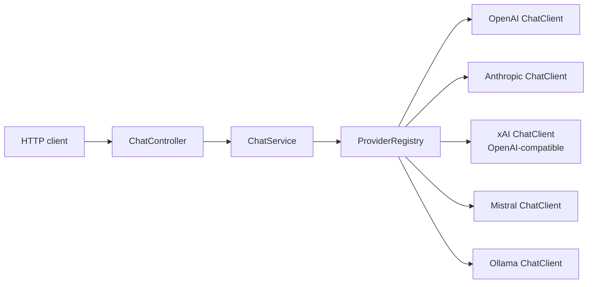
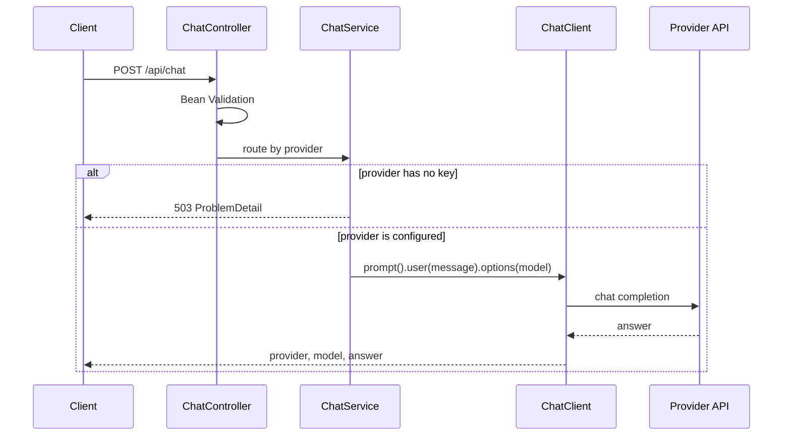

# LLM Gateway

A small Spring Boot service that sends one chat message to **OpenAI**, **Anthropic**, **xAI Grok**, **Mistral**, or a local **Ollama** server. The caller picks the provider on each request. Spring AI's `ChatClient` does the call.

It is meant as a portfolio slice: one clear HTTP contract, keys only in the environment, a consistent error shape, OpenAPI, and tests that never touch a live model.

```bash
curl -s http://localhost:8080/api/chat \
  -H 'Content-Type: application/json' \
  -d '{"provider":"grok","message":"Explain virtual threads"}'
```

```json
{"provider":"grok","model":"grok-4.7","answer":"..."}
```

There is no authentication. Do not put this on a public network with live API keys.

## Features

- `POST /api/chat` selects the provider per request, with an optional model override.
- `GET /api/providers` shows which providers are configured. API keys are never returned.
- A missing key does not stop startup. That provider answers `503` with the environment variable to set.
- Bean Validation on the body, and RFC 9457 `ProblemDetail` errors from one handler.
- Swagger UI at [/swagger-ui.html](http://localhost:8080/swagger-ui.html).
- Java 21 virtual threads for the blocking HTTP calls out to providers.

## Architecture

Each provider is a `ChatProvider` built at startup from the official Spring AI 1.1 starter classes (`OpenAiChatModel`, `AnthropicChatModel`, `MistralAiChatModel`, `OllamaChatModel`) and wrapped in a `ChatClient`. xAI Grok reuses the OpenAI client with base URL `https://api.x.ai`. The OpenAI client appends `/v1/chat/completions`, which is xAI's legacy chat-completions endpoint.

Spring AI's starters auto-configure a single chat model, and in 1.1 that auto-configuration turns on when `spring.ai.model.chat` is unset. With four starters on the classpath, leaving it unset would try to build every provider, and a missing key would fail startup. `application.yml` sets those model properties to `none` and builds a `ChatClient` only when the matching key is present (Ollama when it is enabled). The starter artifacts stay on the classpath so the gateway uses the supported client API rather than a hand-rolled HTTP client.





## Endpoint contract

### `POST /api/chat`

| Field | Required | Notes |
| --- | --- | --- |
| `provider` | yes | `openai`, `anthropic`, `grok`, `mistral`, or `ollama` |
| `message` | yes | Trimmed, 1–32000 characters |
| `model` | no | Overrides the provider default. At most 128 characters |

`200` body:

| Field | Notes |
| --- | --- |
| `provider` | The provider that answered |
| `model` | Model id from the provider metadata, or the model that was requested |
| `answer` | Assistant text |

Errors are `application/problem+json`:

| Status | When |
| --- | --- |
| `400` | Malformed JSON, unknown provider, or validation failure (`errors` lists fields) |
| `502` | The provider was called and failed, was unreachable, or returned an empty answer |
| `503` | The provider is known but not configured |

`503` example:

```json
{
  "title": "Provider not available",
  "status": 503,
  "detail": "Provider 'openai' is not available. Set the OPENAI_API_KEY environment variable.",
  "instance": "/api/chat",
  "provider": "openai"
}
```

### `GET /api/providers`

Returns every supported provider, in a stable order. `available` means the process can try a call. For Ollama that means the provider is enabled, not that the daemon is up. `reason` is omitted when the provider is available.

## Providers

| `provider` | Service | Default model | Enabled by |
| --- | --- | --- | --- |
| `openai` | OpenAI Chat Completions | `gpt-4o-mini` | `OPENAI_API_KEY` |
| `anthropic` | Anthropic Messages | `claude-haiku-4-5` | `ANTHROPIC_API_KEY` |
| `grok` | xAI, via the OpenAI client | `grok-4.7` | `XAI_API_KEY` |
| `mistral` | Mistral Chat Completions | `mistral-small-latest` | `MISTRAL_API_KEY` |
| `ollama` | Local Ollama | `llama3.2` | enabled by default; no API key |

Defaults follow Spring AI 1.1.8 where the library names one (`gpt-4o-mini`, `claude-haiku-4-5`, `mistral-small-latest`). `grok-4.7` is the current xAI chat model on `https://api.x.ai/v1/chat/completions`. `llama3.2` is a common small local model. Override any of them with the environment variables below or with `model` on the request.

Grok calls the chat-completions API that Spring AI's OpenAI client speaks. xAI's newer Responses API is a different protocol and is not used here.

## Prerequisites

- JDK 21. The Maven Wrapper is in the repo, so a system Maven install is optional.
- Docker 23 or newer, only if you run the container.
- An API key for each cloud provider you want to call.
- [Ollama](https://ollama.com) listening on `http://localhost:11434` if you call that provider, with the chosen model pulled (`ollama pull llama3.2`).

## Configuration

Keys are read from the environment. Nothing in this repository is a secret. Copy `.env.example` to `.env` for local overrides; `.env` is gitignored. Spring Boot does not load `.env` by itself. Export the variables, or pass them to Docker Compose, which interpolates `.env` automatically.

| Variable | Default | Purpose |
| --- | --- | --- |
| `OPENAI_API_KEY` | empty | Enables OpenAI. Empty means unavailable. |
| `ANTHROPIC_API_KEY` | empty | Enables Anthropic. |
| `XAI_API_KEY` | empty | Enables Grok. |
| `MISTRAL_API_KEY` | empty | Enables Mistral. |
| `OPENAI_MODEL` | `gpt-4o-mini` | Default OpenAI model. |
| `ANTHROPIC_MODEL` | `claude-haiku-4-5` | Default Anthropic model. |
| `ANTHROPIC_MAX_TOKENS` | `1024` | Anthropic requires a max token count. |
| `XAI_MODEL` | `grok-4.7` | Default Grok model. |
| `XAI_BASE_URL` | `https://api.x.ai` | Host only. Do not append `/v1`. |
| `MISTRAL_MODEL` | `mistral-small-latest` | Default Mistral model. |
| `OLLAMA_ENABLED` | `true` | Set `false` to report Ollama as unavailable. Compose defaults this to `false`. |
| `OLLAMA_BASE_URL` | `http://localhost:11434` | Ollama server. Compose points this at the `ollama` service. |
| `OLLAMA_MODEL` | `llama3.2` | Default Ollama model. |
| `OPENAI_BASE_URL` | `https://api.openai.com` | Optional OpenAI-compatible base URL. |
| `ANTHROPIC_BASE_URL` | `https://api.anthropic.com` | Optional Anthropic base URL. |
| `MISTRAL_BASE_URL` | `https://api.mistral.ai` | Optional Mistral base URL. |
| `LLM_CONNECT_TIMEOUT` | `5s` | TCP connect timeout for provider calls. |
| `LLM_READ_TIMEOUT` | `120s` | Read timeout. Grok reasoning calls can be slow. |

Provider calls are not retried. A failed call surfaces as `502` so the client can decide whether to try again.

## Run locally

```bash
export OPENAI_API_KEY=...
export ANTHROPIC_API_KEY=...
export XAI_API_KEY=...
export MISTRAL_API_KEY=...

./mvnw spring-boot:run
```

The process listens on port `8080`. With no keys exported it still starts; only Ollama is available, and only if something is listening there.

Swagger UI: http://localhost:8080/swagger-ui.html

OpenAPI document: http://localhost:8080/v3/api-docs

`GET /` redirects to Swagger UI.

### curl

List providers:

```bash
curl -s http://localhost:8080/api/providers
```

OpenAI:

```bash
curl -s http://localhost:8080/api/chat \
  -H 'Content-Type: application/json' \
  -d '{"provider":"openai","message":"Explain virtual threads in one paragraph"}'
```

Anthropic:

```bash
curl -s http://localhost:8080/api/chat \
  -H 'Content-Type: application/json' \
  -d '{"provider":"anthropic","message":"Explain virtual threads in one paragraph"}'
```

Grok, with an explicit model:

```bash
curl -s http://localhost:8080/api/chat \
  -H 'Content-Type: application/json' \
  -d '{"provider":"grok","model":"grok-4.7","message":"Explain virtual threads in one paragraph"}'
```

Mistral:

```bash
curl -s http://localhost:8080/api/chat \
  -H 'Content-Type: application/json' \
  -d '{"provider":"mistral","message":"Explain virtual threads in one paragraph"}'
```

Ollama (the daemon must be running and the model pulled):

```bash
curl -s http://localhost:8080/api/chat \
  -H 'Content-Type: application/json' \
  -d '{"provider":"ollama","message":"Explain virtual threads in one paragraph"}'
```

Missing key:

```bash
curl -s -i http://localhost:8080/api/chat \
  -H 'Content-Type: application/json' \
  -d '{"provider":"openai","message":"Hello"}'
```

## Docker

The image is a multi-stage build. Tests run in CI; the image build skips them and copies only the jar onto a Java 21 JRE. The process runs as uid `10001`.

```bash
docker build -t llm-gateway .
docker run --rm -p 127.0.0.1:8080:8080 \
  -e OPENAI_API_KEY \
  -e ANTHROPIC_API_KEY \
  -e XAI_API_KEY \
  -e MISTRAL_API_KEY \
  llm-gateway
```

Compose reads `.env` for the same variables. Ollama is a profile so a normal start does not pull the model image. Its port is bound to loopback.

```bash
docker compose up --build
```

Gateway plus Ollama:

```bash
OLLAMA_ENABLED=true docker compose --profile ollama up --build
docker compose exec ollama ollama pull llama3.2
```

## Tests

```bash
./mvnw verify
```

Unit and `@WebMvcTest` cases mock the model. `ChatClient` is exercised against a mocked `ChatModel`, so the prompt, model override, and answer mapping are real and no network call is made. `@SpringBootTest` boots the application with no keys, checks the `503` body, and checks that a configured key flips `available` without being echoed back. `./mvnw verify` does not need API keys.

## Add a provider

1. Add a constant to `ProviderId` (wire name, display name, environment variable).
2. Add a block under `llm.providers` in `application.yml`, bound from an environment variable with an empty default.
3. Add a factory method in `ChatProviderConfiguration` that builds the Spring AI `ChatModel` and a `ChatClient` when the key is present, and an `UnavailableChatProvider` when it is not. Register it in the `ProviderRegistry` bean.
4. Document the variable in the table above and add a curl example.
5. Extend `LlmGatewayApplicationTest` so the new provider shows up in `GET /api/providers`, and mock a `ChatModel` if the request options differ.

xAI is the pattern for an OpenAI-compatible API: same `OpenAiChatModel`, different base URL and key.

## Tech stack

| Piece | Version |
| --- | --- |
| Java | 21 |
| Spring Boot | 3.5.16 |
| Spring AI | 1.1.8 (the current 1.1 line; Spring AI 2.x targets Spring Boot 4) |
| Starters | `spring-ai-starter-model-openai`, `spring-ai-starter-model-anthropic`, `spring-ai-starter-model-mistral-ai`, `spring-ai-starter-model-ollama` |
| API docs | springdoc-openapi 2.8.17, Swagger UI at `/swagger-ui.html` |
| Build | Maven Wrapper, `./mvnw verify` |
| CI | GitHub Actions on JDK 21 Temurin |
| Container | Eclipse Temurin 21 JRE, non-root |

## License

[MIT](LICENSE). Copyright 2026 Michel Plainchamp.
